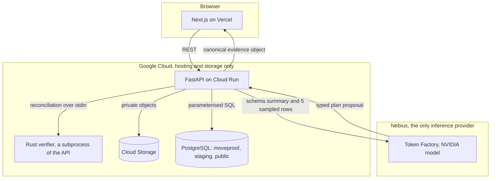
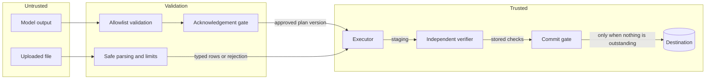
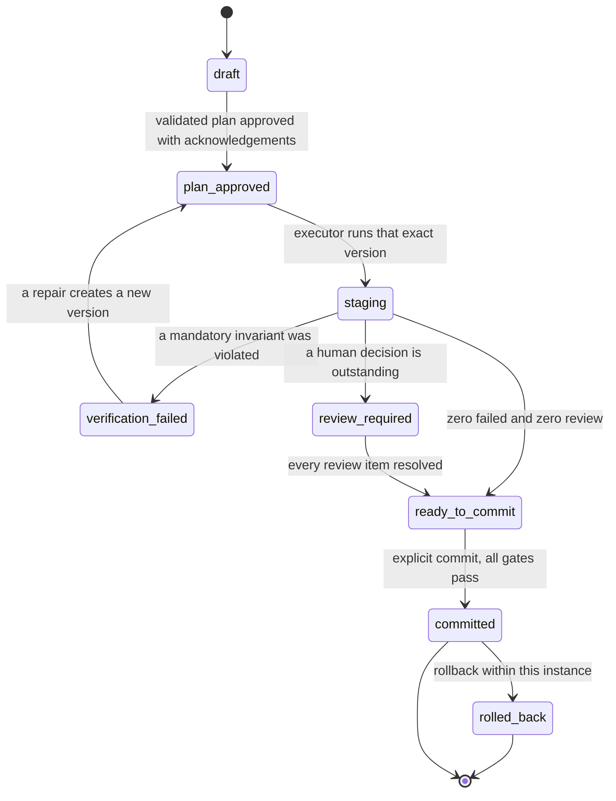
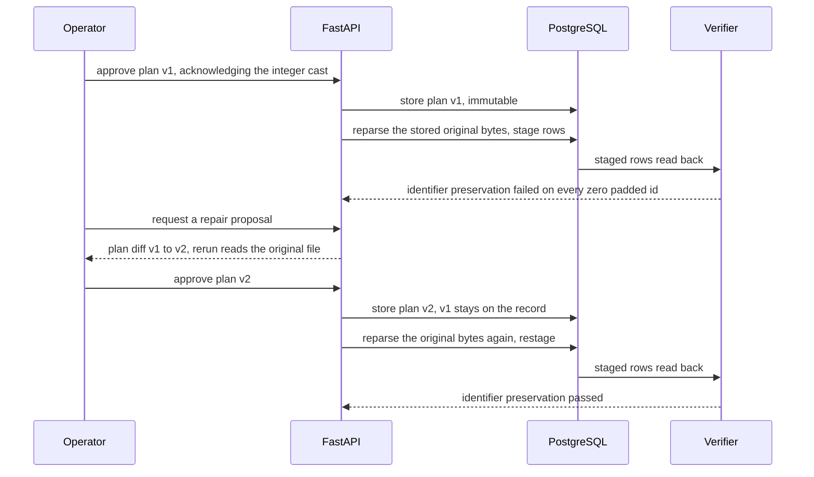
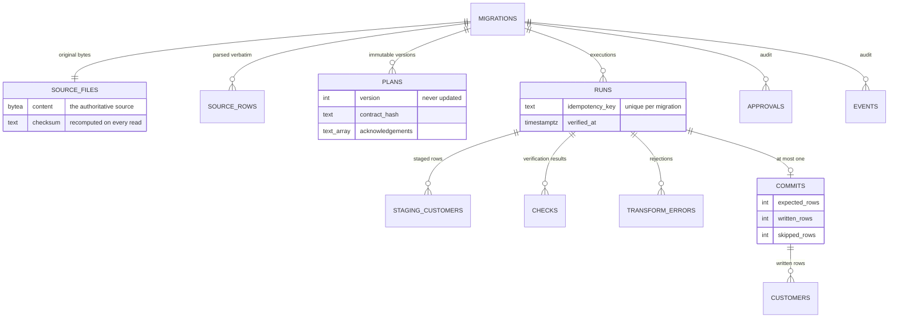

<div align="center">


### Move data. Prove what changed.

An AI assisted data migration workspace that verifies its own work and shows you the evidence.

[](https://github.com/wiqi-lee/moveproof/actions/workflows/ci.yml)
[](LICENSE)
[](https://nextjs.org)
[](https://fastapi.tiangolo.com)
[](https://www.rust-lang.org)

[Live app](https://moveproof.vercel.app) · [Demo video](https://youtube.com/watch?v=REPLACE_WITH_DEMO_ID) · [Devpost entry](https://devpost.com/software/moveproof) · [Hackathon](https://nebiusglobalaihackathon.devpost.com/)

Built by [Wiqi Lee](https://x.com/wiqi_lee) for the Nebius x NVIDIA Global AI Hackathon 2026

</div>

---

## Contents

- [The problem](#the-problem)
- [What MoveProof does](#what-moveproof-does)
- [Honest status](#honest-status)
- [Quick start](#quick-start)
- [Running the whole stack](#running-the-whole-stack)
- [Testing](#testing)
- [Synthetic data and the demo](#synthetic-data-and-the-demo)
- [Architecture](#architecture)
- [Project structure](#project-structure)
- [The API](#the-api)
- [Environment variables](#environment-variables)
- [Nebius and NVIDIA](#nebius-and-nvidia)
- [The Rust verifier](#the-rust-verifier)
- [Reports](#reports)
- [Security](#security)
- [Deployment](#deployment)
- [Design system](#design-system)
- [Roadmap](#roadmap)
- [Licence](#licence)
- [Author](#author)

---

## The problem

A spreadsheet holds a customer id of `00127`. Someone imports it into a database. The import reports success. Every row lands. No error appears anywhere in the log.

The value in the database is now `127`.

An integer cast stripped the leading zero. Nothing was flagged because nothing was technically wrong: the destination accepted an integer, the row count matched, the process came back clean. The identifier simply no longer identifies the same customer, and nobody will notice until an invoice goes to the wrong person months later.

This is the ordinary shape of migration damage, and it recurs in a small number of forms.

| What happens | Why it goes unnoticed |
| --- | --- |
| An integer cast strips a leading zero | The row imported successfully and the count matched |
| A locale guess turns 3 April into 4 March | Both readings are valid dates |
| A float conversion loses a fraction of a cent | The total is close enough to look right |
| A duplicate is silently dropped | Fewer rows arrived, and nobody agreed on what should happen |
| A required field arrives empty | The row is rejected quietly, or a placeholder is invented |

Three things make this worse in practice. The damage is silent: a migration that destroys data and one that preserves it produce the same success message. The people doing it are usually operations staff rather than database specialists, and a wrong cast applied consistently across ten thousand rows looks exactly like success. Afterwards there is no record of which transformations ran, who approved them, or which properties were ever checked.

---

## What MoveProof does

Spreadsheet data goes into a structured database. The transformation is proposed by a model, executed by deterministic code, and then checked by a verifier that had no part in writing it.

> **AI proposes. Validated code executes. Independent evidence decides. Humans approve ambiguity.**

Each clause is a constraint in the codebase rather than a slogan.

**AI proposes.** An NVIDIA model served through Nebius Token Factory reads the source schema and a five row sample, then returns a typed mapping proposal. It never emits SQL, shell commands or code.

**Validated code executes.** Every proposed operation is checked against an allowlist before a human sees it. `approve()` takes a validation result rather than a plan, so a proposal cannot become executable merely by calling a function on it. Lossy operations need an acknowledgement recorded per column by name. The executor refuses a plan whose mappings are not marked approved, which closes the path where a caller builds an approved-looking plan by hand.

**Evidence decides.** A verifier that shares no code with the planner reads the rows back out of the database and reports four outcomes that do not overlap: passed, failed, review required, and not verified. Commit is gated in the database layer against stored check rows, so a screen that forgets to disable a button still cannot commit.

**Humans approve ambiguity.** When `03/04/2024` reads correctly two ways, the product asks. The answer becomes part of the versioned contract and is applied identically during execution and verification.

### What it does not claim

A passed verification means the invariants in the approved contract held. It does not mean every possible semantic error has been ruled out. The evidence report carries a limitations section naming every property that was not checked.

Human approvals recorded in a report are audit entries. They are not cryptographic signatures, and nothing in the product describes them as such.

---

## Honest status

The distinction between written and verified matters more here than usual, so it is stated first.

| Component | Implemented | Tested | How to verify it yourself |
| --- | --- | --- | --- |
| CSV and XLSX parsing | Yes | **Yes, executed** | `make test-core` |
| Plan validation and the operation allowlist | Yes | **Yes, executed** | `make test-core` |
| Approval gate, negative cases | Yes | **Yes, executed** | `make test-core` |
| Deterministic executor | Yes | **Yes, executed** | `make test-core` |
| Verification engine | Yes | **Yes, executed** | `make test-core` |
| Canonical hashing, Python side | Yes | **Yes, executed** | `make test-core` |
| Synthetic generator and manifest | Yes | **Yes, executed** | `make test-core` |
| PDF and HTML rendering | Yes | **Yes, executed** | `make test-core` |
| Rust verifier | Yes | **Not executed**, no toolchain during development | `make rust rust-test` |
| Python and Rust parity | Yes | **Skipped** without the binary | `make rust` then `make test-core` |
| PostgreSQL staging, idempotency, commit gate | Yes | **Not executed** | `make db-up migrate test-db` |
| FastAPI, all endpoints | Yes | **Not executed** | `make db-up migrate test-db` |
| Frontend to backend workflow | Yes | **Not executed** | Run both and walk the demo |
| Live Nebius inference | Yes | **Blocked**, needs a credential | `make smoke` |
| Deployment | Configured | **Not deployed** | `deploy/DEPLOYMENT.md` |

**Executed during development: 74 tests passed, 0 failed, 19 skipped.** The skips are the parity tests, which need the Rust binary.

**Not executed: 50 database and API tests, 16 Rust tests, and the entire frontend to backend path.** Their code is written and their commands are below, but none of it has been run. Treat every row marked "not executed" as unverified until you have run it and seen it pass.

---

## Quick start

Node 20 or newer, Python 3.12 or newer, Docker, and optionally Rust.

```bash
# 1. Frontend dependencies
npm install

# 2. Backend, database and schema
cd backend
python -m venv .venv && source .venv/bin/activate
pip install -r requirements-dev.txt
make db-up migrate

# 3. The Rust verifier. Without it, canonical reconciliation
#    reports "not verified" rather than passing.
make rust

# 4. Start the API on :8000
make api
```

In a second terminal, from the repository root:

```bash
cp .env.local.example .env.local
npm run dev
```

Open <http://localhost:3000>. The workspace is at `/app`.

If the backend is not running, the workspace shows a red banner saying so rather than an empty state. "No migrations" and "cannot reach the backend" mean very different things.

---

## Running the whole stack

### Frontend

```bash
npm run dev        # development server on :3000
npm run build      # production build
npm start          # serve the production build
npm run lint       # ESLint, Next.js core web vitals
npm run typecheck  # tsc --noEmit, strict
```

### Backend

Run these from `backend/` with the virtual environment active.

```bash
make install    # create .venv and install everything
make db-up      # PostgreSQL 16 in Docker on port 5433
make migrate    # apply sql/*.sql in order
make api        # uvicorn on :8000 with reload
make db-down    # stop the database
make reset      # delete every migration and committed row, keep the schema
```

Port 5433 is deliberate, so a PostgreSQL already running on 5432 is left alone.

Interactive API docs are at <http://localhost:8000/docs>.

### Rust verifier

```bash
cd rust-verifier
cargo build --release
cargo test
cargo clippy -- -D warnings
```

Or from `backend/`: `make rust` and `make rust-test`.

The Python bridge looks for the binary at `rust-verifier/target/release/moveproof-verifier`, then on `PATH`, then at `MOVEPROOF_VERIFIER_BIN`.

### Nebius

```bash
cd backend
export NEBIUS_API_KEY='your-key'
make smoke
```

Independent of everything else. Run it the moment you have a credential rather than waiting for the rest of the stack. Without a key it exits with a clear message and code 2, and every other command still works.

---

## Testing

```bash
cd backend

make test-core   # no database, no network, about a second
make test-db     # staging, commit gate, and every API endpoint
make test        # both
make bench       # measures Python against Rust reconciliation
```

These are pytest markers underneath, so you can be more selective:

```bash
pytest -v -m "not database"          # the core suite
pytest -v -m database                # requires DATABASE_URL and PostgreSQL
pytest tests/test_canonical.py -v    # canonicalisation and Rust parity
pytest tests/test_reports.py -v      # PDF and HTML rendering
```

### What each suite covers

| File | Covers | Needs |
| --- | --- | --- |
| `test_pipeline.py` | Parsing, plan versioning, executor, repair, the hazard scenarios | Nothing |
| `test_generated.py` | The generator, and that the verifier independently finds what it planted | Nothing |
| `test_approval.py` | Negative cases: fatal validation, unacknowledged lossy casts, forged plans | Nothing |
| `test_canonical.py` | Canonicalisation rules, and parity between Python and Rust | Rust for parity |
| `test_reports.py` | Real PDF bytes, page count, HTML escaping, three formats agreeing | reportlab |
| `test_database.py` | Staging, idempotency, conflicts, the commit gate, rollback | PostgreSQL |
| `test_api.py` | Every endpoint, and the full workflow over HTTP | PostgreSQL |

A test that needs something unavailable skips with a reason rather than passing quietly.

---

## Synthetic data and the demo

The repository generates its own test data. Nothing needs downloading.

```bash
cd backend
make fixtures    # 100, 1000 and 10000 row files with hazards
python scripts/generate_fixtures.py --out tests/fixtures/generated --sizes 500 --clean
```

A fixed seed means the same size always produces byte identical output. Each file gets a `.manifest.json` recording which rows carry which hazard.

**The manifest is test metadata.** The application never opens it. Tests load it to know the correct answer, then assert that the pipeline found the same thing by executing real checks. `tests/test_generated.py` is written that way throughout.

Twelve hazard kinds are planted: leading zero identifiers, exact duplicates, conflicting duplicate keys, missing required fields, ambiguous dates, invalid dates, decimal overscale, numeric overflow, unexpected Unicode, long text, formula-like cells, and prompt injection text inside untrusted cells.

### Walking the demonstration

1. Upload `backend/tests/fixtures/clean.csv` at `/app/migrations/new`.
2. On the mapping step choose the **legacy import profile**. It casts `customer_id` to an integer, exactly as an older importer would.
3. The approve button stays disabled until you tick the acknowledgement. Tick it and approve.
4. Stage and run, then run verification.
5. Identifier preservation fails. Every zero padded identifier is damaged, not just the first, and the check reports the true count rather than the size of the evidence sample.
6. Try to commit. It is refused.
7. Open the repair proposal. It shows the plan diff and explains that the rerun reparses the original upload, because a leading zero destroyed by an integer cast cannot be recovered from the integer.
8. Approve the revision. It reruns and reverifies, and identifier preservation passes.
9. Commit. Download the evidence as JSON, HTML and PDF and confirm all three agree.

Reset with `make reset`.

---

## Architecture

### Runtime



Google Cloud performs no inference. Vertex AI and Gemini are deliberately absent: routing model calls through them would put the project outside the hackathon rules regardless of output quality.

### Trust boundary



No arrow reaches the executor without passing validation, and none reaches the destination without passing the commit gate.

### The commit gate



`assert_commit_allowed` checks seven conditions against stored records: the run belongs to this migration, the executed plan version was approved, no newer plan has since been approved, the contract hash matches on both the run and the plan, every mandatory check is present, none is failed or awaiting review, and the verification does not predate the execution it describes. The migration row is locked `FOR UPDATE` first, so two concurrent attempts cannot both pass.

A mandatory check that never ran blocks a commit exactly as firmly as one that failed.

### Repair



Every run reparses the stored original upload. No run ever reads a previous run's staged output, which is what makes the repair honest rather than a claim in the interface.

### Data model



`moveproof.commits` carries `CHECK (written_rows + skipped_rows = expected_rows)`, so the database refuses an unreconciled commit record even if the code path were wrong.

---

## Project structure

```
moveproof/
├── src/                                  Next.js frontend
│   ├── app/
│   │   ├── page.tsx                      Public landing page
│   │   ├── layout.tsx                    Fonts, metadata, no-flash theme script
│   │   ├── globals.css                   Colour tokens, light and dark
│   │   └── app/                          The workspace
│   │       ├── layout.tsx                Provider, navigation, connection banner
│   │       ├── page.tsx                  Overview, real migration records
│   │       ├── migrations/page.tsx       Filterable migration index
│   │       ├── migrations/new/page.tsx   Four step wizard
│   │       ├── migrations/[id]/run/      Execution
│   │       ├── migrations/[id]/verification/
│   │       ├── migrations/[id]/repair/
│   │       ├── migrations/[id]/report/
│   │       ├── reports/page.tsx          Report index with working exports
│   │       ├── settings/page.tsx         Theme, and real backend capabilities
│   │       └── docs/page.tsx             Product documentation
│   ├── components/
│   │   ├── ui/                           Button, StatusPill, Stepper, dialogs, theme toggle
│   │   ├── landing/                      Hero with the interactive preview, sections, footer
│   │   ├── workspace/                    Sidebar with drawer, top bar, command palette
│   │   └── migration/                    Wizard steps, verification, repair, evidence report
│   ├── domain/
│   │   ├── types.ts                      The status vocabulary the UI renders
│   │   └── status.ts                     Presentation classes and the state machine
│   ├── data/api.ts                       The one adapter between API payloads and the UI
│   └── lib/
│       ├── api-client.ts                 Typed HTTP client with typed errors
│       ├── api-types.ts                  Wire shapes mirroring the FastAPI contract
│       ├── migration-store.tsx           One store, every value from the backend
│       ├── theme.tsx                     Light, dark and system with persistence
│       ├── routes.ts                     Every internal destination in one place
│       └── site.ts                       Author details and external links
│
├── backend/
│   ├── app/
│   │   ├── api/main.py                   19 endpoints, deliberately thin
│   │   ├── services/
│   │   │   ├── pipeline.py               Every workflow decision
│   │   │   └── evidence.py               The canonical evidence object
│   │   ├── domain/                       No web framework, no database driver
│   │   │   ├── types.py                  Typed vocabulary, Decimal for money
│   │   │   ├── contract.py               Mandatory checks and contract hashing
│   │   │   ├── plan.py                   Allowlist validation, hardened approval
│   │   │   ├── plans.py                  Safe and legacy proposal profiles
│   │   │   ├── schema.py                 The destination schema
│   │   │   └── verification.py           The independent verifier
│   │   ├── ingest/parser.py              Safe CSV and XLSX reading
│   │   ├── execute/executor.py           Runs only what the approved plan says
│   │   ├── verify/
│   │   │   ├── canonical.py              Reference canonicalisation and hashing
│   │   │   ├── rust_bridge.py            Subprocess bridge, honest fallback
│   │   │   └── db_verifier.py            Verification against rows read back
│   │   ├── reports/{pdf,html}.py         Rendered from the canonical object
│   │   ├── db/                           Connection, migrations, repository
│   │   └── nebius/client.py              Token Factory, JSON only
│   ├── sql/                              Numbered schema migrations
│   ├── scripts/                          Fixture generator, Nebius smoke test, benchmark
│   ├── tests/                            7 suites
│   ├── Dockerfile                        Two stage, compiles and tests the Rust verifier
│   ├── docker-compose.yml                Local PostgreSQL on 5433
│   └── Makefile                          Every reproducible command
│
├── rust-verifier/                        Canonical hashing and reconciliation
│   ├── src/lib.rs                        Rules, mirrored from canonical.py
│   ├── src/main.rs                       JSON on stdin, JSON on stdout
│   └── tests/integration.rs
│
├── deploy/
│   ├── DEPLOYMENT.md                     Vercel, Cloud Run, Cloud SQL, storage, costs
│   ├── cloudrun.yaml                     Secrets referenced, never inlined
│   └── storage-lifecycle.json
│
├── docs/ARCHITECTURE.md                  Why each boundary is where it is
├── .github/workflows/ci.yml              Frontend, Rust, backend with PostgreSQL, hygiene
├── vercel.json
├── LICENSE
└── README.md
```

`backend/app/domain` imports no web framework and no database driver. That is what keeps the rules testable in a second and impossible for a route to quietly contradict.

---

## The API

| Method | Path | Purpose |
| --- | --- | --- |
| GET | `/health` | Database, Nebius, Rust and PDF availability, reported separately |
| GET | `/api/schema/destination` | The destination schema and the contract hash |
| POST | `/api/migrations` | Upload a CSV or XLSX file |
| GET | `/api/migrations` | Index with plan and run state folded in |
| GET | `/api/migrations/search?q=` | Search by filename or id, used by the command palette |
| GET | `/api/migrations/{id}` | One migration and its plan versions |
| GET | `/api/migrations/{id}/preview` | Real source rows |
| GET | `/api/migrations/{id}/events` | Audit events |
| DELETE | `/api/migrations/{id}` | Delete a migration and everything derived from it |
| POST | `/api/migrations/{id}/plan/propose?profile=` | Propose a mapping: `safe`, `legacy` or `model` |
| POST | `/api/migrations/{id}/plan/approve` | Approve with acknowledgements recorded by column |
| POST | `/api/migrations/{id}/run` | Stage, honouring an `Idempotency-Key` header |
| POST | `/api/migrations/{id}/runs/{run}/verify` | Run the verifier and store the result |
| GET | `/api/migrations/{id}/runs/{run}/verification` | Stored check results |
| POST | `/api/migrations/{id}/runs/{run}/repair/propose` | Diagnose and propose a revision |
| POST | `/api/migrations/{id}/runs/{run}/commit` | Commit, subject to every gate |
| POST | `/api/migrations/{id}/rollback` | Remove this migration's committed rows |
| GET | `/api/migrations/{id}/evidence` | The canonical evidence object as JSON |
| GET | `/api/migrations/{id}/report.html` | The same object as a standalone document |
| GET | `/api/migrations/{id}/report.pdf` | The same object as a PDF |

Errors carry a `kind` so the interface can tell a blocked commit from a network failure: `workflow`, `commit_gate`, `parse`, `integrity`, `source`.

A request is one transaction. The connection dependency commits only when the handler returns, so a failure part way through leaves nothing behind.

---

## Environment variables

Nothing is required to run the frontend against a local backend.

### Frontend, `.env.local`

| Variable | Purpose | Default |
| --- | --- | --- |
| `NEXT_PUBLIC_API_BASE_URL` | Where the backend lives | `http://localhost:8000` |
| `NEXT_PUBLIC_SITE_URL` | Canonical links and metadata | `http://localhost:3000` |

Only `NEXT_PUBLIC_` values reach the browser, and none of them is a secret.

### Backend

| Variable | Purpose | Default |
| --- | --- | --- |
| `DATABASE_URL` | PostgreSQL connection | local on port 5433 |
| `MAX_UPLOAD_BYTES` | Upload ceiling | 26214400, 25 MB |
| `REQUEST_TIMEOUT_SECONDS` | Outbound timeout | 60 |
| `MODEL_SAMPLE_ROWS` | Rows sent to the model, ever | 5 |
| `CORS_ORIGINS` | Comma separated allowed origins | localhost:3000 |
| `NEBIUS_API_KEY` | Token Factory credential | none, fails loudly |
| `NEBIUS_BASE_URL` | Token Factory endpoint | `https://api.studio.nebius.com/v1` |
| `NEBIUS_MODEL_ID` | Confirm with the smoke test, do not guess | none |
| `MOVEPROOF_VERIFIER_BIN` | Override the Rust binary path | auto-detected |

The Nebius key carries no `NEXT_PUBLIC_` prefix and never will. Put it in your shell or in Secret Manager, not in a file the frontend can read.

---

## Nebius and NVIDIA

**Track: Best Apps and Agents.**

The model does work that is genuinely hard to encode as rules: reading an unfamiliar schema, recognising that a column of mixed date formats is a hazard rather than noise, and explaining a failure in terms an operator can act on.

Four reasoning tasks are given to it: schema interpretation and mapping, risk identification, failure diagnosis, and repair proposal.

Four constraints apply to all of them.

- Model output is untrusted input, validated against the operation allowlist before it reaches a human or the executor. An operation name the model invents is discarded during parsing and would be rejected by validation anyway.
- The model never emits SQL, shell commands or executable code.
- Full datasets are never sent. `pipeline._sample_for_model` slices the rows to `MODEL_SAMPLE_ROWS` and is the only path from stored rows to a prompt, so the claim is enforced in one place rather than asserted in the interface.
- Model name, request id and token usage are logged. Field values are not.

Two deterministic proposal profiles work with no credential at all, so the product is usable and testable before Nebius is wired up. The model profile is disabled in the interface when `/health` reports no credential, rather than failing when clicked.

**Confirm the model id with `make smoke` rather than trusting a value written here.**

---

## The Rust verifier

Its role is whole row reconciliation. Every other check examines one property; this one collapses each row to a canonical string under fixed rules and compares hashes, so it catches damage nobody wrote a rule for. It is also the part of verification that touches every row of every dataset.

The rules are strict about exactly the things that go wrong quietly:

- `00127` and `127` never hash the same. An identifier is never normalised numerically.
- `1200.50` and `1200.5` do hash the same. A decimal is normalised numerically.
- `1200.4999` differs from both.
- `Zoë` and `Zoe` plus a combining diaeresis hash the same, after NFC normalisation.
- Null and empty string are different facts.
- Field order never affects the result.

**When the binary is not built, canonical reconciliation reports `not_verified` with the reason. It is never reported as passed, and the Python reference implementation is never quietly substituted to make it look as though Rust ran.** The Python version exists to hold Rust to its output in `tests/test_canonical.py`, which fails on any divergence.

The check is advisory rather than mandatory in the contract, so an unbuilt binary cannot become the reason a correct migration is unable to commit. When it does run and fails, it fails loudly.

No performance claim is made anywhere without a number from `make bench`. The Python side measured 84 ms for 5000 rows across 5 fields during development. The Rust figure has not been measured.

---

## Reports

HTML, JSON and PDF all render the output of `app/services/evidence.py` and nothing else. They are pure functions of one dictionary, which is what makes disagreement impossible rather than unlikely. `test_reports.py` asserts that rendering does not mutate the object.

The evidence object carries the migration and run ids, the source checksum and size, the destination schema version, the approved plan version with its acknowledgements and contract hash, execution timestamps, applied operations, transformation errors, row accounting as arithmetic, every check with its evidence, discrepancies, human approvals, commit reconciliation, and an explicit limitations section.

The PDF is generated server side with reportlab: A4, repeated table headers so a long check list stays readable across pages, and a footer carrying the migration id, run id and page number so a printed sheet can be traced back. When reportlab is unavailable, `/health` says so and the interface disables the action rather than offering a button that fails.

---

## Security

| Control | Status |
| --- | --- |
| File type and size validation | Implemented, `ingest/parser.py` |
| Safe parsing, no formula evaluation | Implemented and tested |
| Formula-like cells stored verbatim, escaped only on output | Implemented and tested |
| Operation allowlist for model output | Implemented and tested |
| Acknowledgement required for lossy operations | Implemented and tested |
| Parameterised SQL everywhere | Implemented |
| Least privilege database and cloud credentials | Configured in `deploy/` |
| Secrets never in the browser | Implemented, no secret carries `NEXT_PUBLIC_` |
| Only a schema summary and five rows sent to the model | Implemented, one code path |
| HTML output escaped against untrusted cell text | Implemented and tested |
| Transactional commit with a fail closed conflict policy | Implemented, not yet tested |
| Idempotent retries | Implemented, not yet tested |
| Audit logging without field values | Implemented |
| Private object storage with lifecycle deletion | Configured, not deployed |

Marking a control as implemented but not tested is deliberate. A product about verifiable claims should not make unverifiable ones about itself.

Report a security issue by opening a GitHub issue. Do not include real data or credentials.

---

## Deployment

Full instructions, including cost controls and a six point verification checklist, are in [`deploy/DEPLOYMENT.md`](deploy/DEPLOYMENT.md).

In short: frontend on Vercel, backend on Cloud Run from a two stage image that compiles and tests the Rust verifier, PostgreSQL on Cloud SQL, files in a private Cloud Storage bucket with 90 day lifecycle deletion, inference on Nebius.

Two notes worth repeating. A Google Cloud budget alert is a notification, not a spending cap; the controls that actually bound spend are `maxScale` on Cloud Run and stopping the SQL instance between demonstrations. And no GPU is provisioned anywhere, because Token Factory serves the model.

---

## Design system

| Token | Light | Dark | Meaning |
| --- | --- | --- | --- |
| `canvas` | `#F7F8FA` | `#0B1120` | Page background |
| `surface` | `#FFFFFF` | `#111827` | Cards and tables |
| `navy` | `#172554` | `#2563EB` | Brand identity, primary actions |
| `brand` | `#3B82F6` | `#60A5FA` | Active controls and selection |
| `ok` | `#15803D` | `#4ADE80` | A check ran and succeeded |
| `bad` | `#B91C1C` | `#F87171` | An approved invariant was violated |
| `warn` | `#B45309` | `#FBBF24` | A human decision is outstanding |
| `neutral` | `#475569` | `#94A3B8` | The property was never checked |

Colours are CSS variables holding RGB triplets, so one set of class names works in both themes and Tailwind opacity modifiers still compose. There is no hex literal in any component.

Typography is Inter for the interface and JetBrains Mono for identifiers, hashes and data.

Four rules hold across every screen. Status is never carried by colour alone: each badge pairs a colour with an icon shape and a text label. Wide tables scroll inside their own container so the page never scrolls sideways. Keyboard focus stays visible and `prefers-reduced-motion` is respected. Every interactive control is either functional or visibly disabled with a reason.

### Command palette

`⌘ K` on macOS, `Ctrl K` elsewhere, `/` when not typing, or the visible search button, which is the accessible route on a phone. Arrow keys move, Enter activates, Escape closes, and focus returns to whatever opened it.

It navigates and it changes the theme. It cannot approve a plan, run a verification or commit a migration: those decisions belong to screens that show the evidence behind them. Migration search queries the backend. Commands appear only when they are actually available, so there is no entry for resuming a draft that does not exist.

---

## Roadmap

### Complete

- [x] Deterministic core: parsing, plan versioning, allowlist, executor, verifier
- [x] Hardened approval bound to a contract hash, with recorded acknowledgements
- [x] PostgreSQL staging, idempotent runs, fail closed commit gate, rollback
- [x] Original source bytes preserved with integrity checks
- [x] FastAPI with 19 endpoints and a canonical evidence object
- [x] Frontend fully wired to the backend, with no hardcoded results anywhere
- [x] Rust verifier with a real pipeline role and parity tests
- [x] HTML, JSON and PDF reports from one object
- [x] Command palette, dark mode, responsive workspace
- [x] Synthetic generator with twelve hazard kinds and a test-only manifest
- [x] Deployment configuration and CI across all three languages

### Before submission

- [ ] Run the database and API suites and fix what they surface
- [ ] Build the Rust verifier and run the parity tests
- [ ] A real Token Factory call, with the model id recorded
- [ ] Deploy and verify against the six point checklist
- [ ] Replace the placeholder links in `src/lib/site.ts`
- [ ] Record the demo video

### Considered and deliberately deferred

- Multi database destinations, streaming ETL, enterprise SSO and billing. None strengthens the core workflow for the target user.
- A native Python extension for the Rust verifier. The subprocess boundary is easier to test from both sides and the transfer cost is small at these dataset sizes. Worth revisiting if `make bench` shows otherwise.

---

## Licence

MIT. See [LICENSE](LICENSE). Copyright 2026 Wiqi Lee.

Nebius and NVIDIA are named throughout to describe the technology in use. Neither company endorses this project. It is an independent hackathon entry.

---

## Author

**Wiqi Lee**, creator and sole developer.

- X: [@wiqi_lee](https://x.com/wiqi_lee)
- Medium: [build notes](https://medium.com/@wiqi_lee)
- YouTube: [demo video](https://youtube.com/watch?v=REPLACE_WITH_DEMO_ID)
- Devpost: [project entry](https://devpost.com/software/moveproof)

Built for the [Nebius x NVIDIA Global AI Hackathon 2026](https://nebiusglobalaihackathon.devpost.com/). Submissions close 30 October 2026 at 10:00 Pacific Time.
