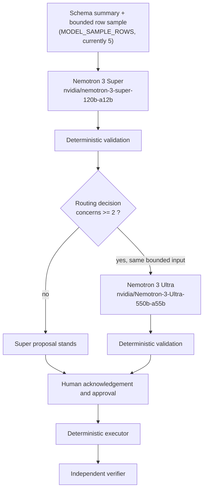
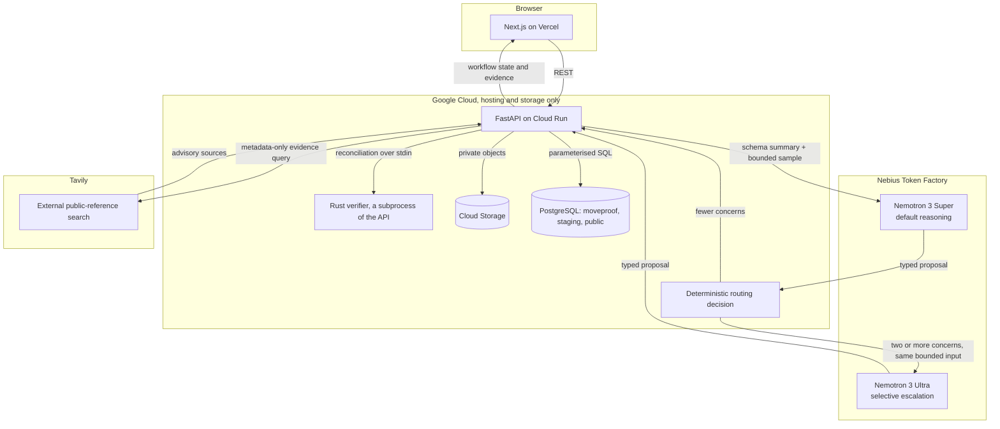
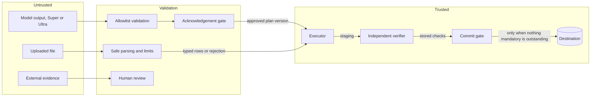
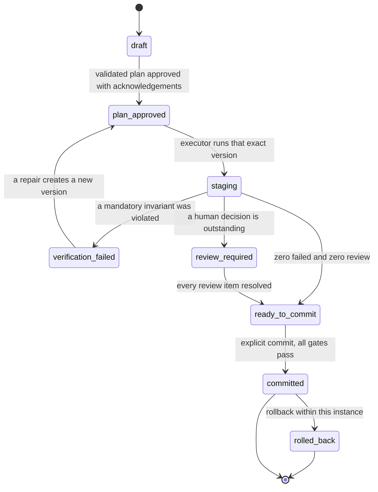
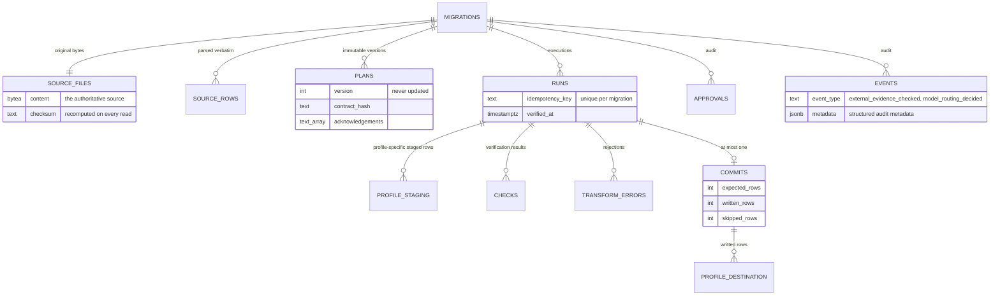

<div align="center">


# MoveProof

### Move data. Prove what changed.

MoveProof is a verification-first workspace for high-stakes structured-data migrations. AI may propose transformations, but only validated and human-approved plans can execute, and independent verification determines whether the migration actually preserved the intended contract.

**AI proposes. Validated code executes. Independent evidence decides. Humans approve ambiguity.**

[](https://github.com/wiqilee/Moveproof/actions/workflows/ci.yml)
[](LICENSE)
[](https://nextjs.org)
[](https://www.python.org)
[](https://fastapi.tiangolo.com)
[](https://www.postgresql.org)
[](https://www.rust-lang.org)
[](https://nebius.com)
[](https://www.nvidia.com)
[](https://tavily.com)
[](https://youtu.be/sTFDnpzNuWM)

[Live app](https://moveproof-wiqi.vercel.app) · [Backend health](https://moveproof-backend-579259634424.asia-southeast2.run.app/health) · [Devpost entry](https://devpost.com/software/moveproof) · [Hackathon](https://nebiusglobalaihackathon.devpost.com/)

Built by [Wiqi Lee](https://x.com/wiqi_lee) for the Nebius x NVIDIA Global AI Hackathon 2026 · Track: **Best Apps & Agents**

NVIDIA Nemotron 3 Super on Nebius Token Factory drafts every model-assisted proposal. Nemotron 3 Ultra is called selectively, only when deterministic validation finds interacting ambiguities. Neither model can execute anything.

</div>

---

## Contents

- [The problem](#the-problem)
- [What MoveProof does](#what-moveproof-does)
- [Why MoveProof](#why-moveproof)
- [How it works](#how-it-works)
- [Selective NVIDIA reasoning](#selective-nvidia-reasoning)
- [Honest status](#honest-status)
- [Quick start](#quick-start)
- [Running the whole stack](#running-the-whole-stack)
- [Testing](#testing)
- [Synthetic data and the demo](#synthetic-data-and-the-demo)
- [Architecture](#architecture)
- [Project structure](#project-structure)
- [The API](#the-api)
- [Environment variables](#environment-variables)
- [Destination profiles](#destination-profiles)
- [Nebius and NVIDIA](#nebius-and-nvidia)
- [The Rust verifier](#the-rust-verifier)
- [Reports](#reports)
- [External Evidence Check](#external-evidence-check)
- [Security](#security)
- [Deployment](#deployment)
- [Design system](#design-system)
- [Roadmap](#roadmap)
- [Licence](#licence)
- [Author](#author)

---

## The problem

Poor data quality is expensive, and migration can make the damage harder to detect. IBM cites a 2025 Institute for Business Value report that found 43% of chief operations officers identified data quality issues as their most significant data priority. Separately, Forrester reported that more than a quarter of organizations estimated losing over USD 5 million annually because of poor data quality. In a 2025 Syniti/UKISUG study, 79% of organizations said data management presents a challenge when moving from ECC 6.0 to S/4HANA.

The dangerous failures are not always the ones that crash a migration. They are the ones that complete successfully.

A spreadsheet holds a customer ID of `00127`. Someone imports it into a database. The import reports success. Every row lands. No error appears in the log.

The value in the database is now `127`.

An integer cast stripped the leading zero. Nothing was technically invalid: the destination accepted the integer, the row count matched, and the process completed successfully. But the stored value no longer matches the identifier in the source.

This is the class of failure MoveProof is designed to expose: transformations that succeed technically while violating the intended data contract.

The same failure mode appears in robotics calibration data. A migration can preserve every row while silently changing a robot ID such as `0017` to `17`, coercing firmware `3.08` away from its intended string representation, or interpreting dates and decimal conventions differently. The pipeline can still report success while the data contract has changed.

| What changes silently | Why it can go unnoticed |
| --- | --- |
| `00127` becomes `127` | The integer is valid and the row count still matches |
| `03/04/2024` becomes `2024-03-04` | Both interpretations are valid dates |
| `1200.50` loses precision | The resulting number is still valid |
| A duplicate is dropped | The operation may look like legitimate deduplication |
| A required field becomes empty | The row may still satisfy the destination schema |

Three things make these failures difficult to catch:

- **Successful execution is not semantic preservation.** A migration can finish cleanly while changing values that matter.
- **Scale hides systematic damage.** The same wrong transformation applied across thousands of rows can look perfectly consistent.
- **Traditional success signals are weak evidence.** Row counts and clean logs do not show what changed, what was approved, or what was actually verified.

MoveProof separates those questions: **what was approved, what actually happened to the data, and what evidence proves the approved contract held.**

**Sources:** [IBM — A compounding threat: The true cost of poor data quality](https://www.ibm.com/think/insights/cost-of-poor-data-quality) · [Forrester — Millions Lost in 2023 Due to Poor Data Quality](https://www.forrester.com/report/millions-lost-in-2023-due-to-poor-data-quality-potential-for-billions-to-be-lost-with-ai-without-intervention/RES181258) · [Syniti/UKISUG — Data Strategies in an S/4HANA and AI World](https://www.sapusers.org/resource/data-strategies-in-an-s-4hana-and-ai-world.html)

---

## What MoveProof does

Spreadsheet data goes into a structured database under an explicit destination contract. MoveProof currently demonstrates the same verification architecture across two profiles: customer-data migration with `customers_v1`, and per-joint robotics calibration migration with `robot_calibration_v1`. In the model-assisted path, NVIDIA Nemotron proposes a typed transformation plan; deterministic proposal profiles are also available and need no credential at all. Validated deterministic code executes the approved plan, and an independent verifier checks the staged result.

MoveProof is not a generic ETL tool, and it is not an agent permitted to mutate production data on its own judgement. It is a verification layer for migrations where silent semantic damage matters.

## Why MoveProof

Most migration tools optimize for getting data from A to B. MoveProof focuses on a different question: **did the data survive the move as intended?**

It adds four things that ordinary import success does not prove:

- **Explicit contracts.** Transformations are reviewed and approved before execution.
- **Independent verification.** The checker does not share planner logic or simply trust the transformation that ran.
- **Human control over ambiguity.** Unclear semantics are surfaced for review instead of guessed silently.
- **Evidence that survives the run.** Plans, approvals, checks, repairs, limitations, and final outcomes remain part of the audit record.

> **AI proposes. Validated code executes. Independent evidence decides. Humans approve ambiguity.**

Each clause is a constraint in the codebase, not just a slogan.

**AI proposes.** An NVIDIA model served through Nebius Token Factory reads the source schema and a bounded row sample, then returns a typed mapping proposal. It never emits SQL, shell commands, or executable code.

**Validated code executes.** Every proposed operation is checked against an allowlist before it can be approved. `approve()` accepts a validation result rather than a raw plan, so a proposal cannot become executable merely by calling an approval function on it. Lossy operations require an acknowledgement recorded for the affected column by name. The executor also refuses plans whose mappings are not explicitly approved, closing the path where a caller constructs an approved-looking plan by hand.

**Independent evidence decides.** A verifier that shares no code with the planner reads the staged rows back from the database and reports four non-overlapping outcomes: passed, failed, review required, and not verified. Commit eligibility is checked again in the database layer against stored check results, so a screen that forgets to disable a button still cannot bypass the gate.

**Humans approve ambiguity.** When a value such as `03/04/2024` admits two valid interpretations, the product asks. The decision becomes part of the versioned contract and is applied consistently during execution and verification. External references may inform that decision, but they never count as verification results.

### What it does not claim

A passed verification means the invariants in the approved contract held. It does not mean every possible semantic error has been ruled out. The evidence report includes a limitations section that names every property that was not checked.

Human approvals recorded in a report are audit entries. They are not cryptographic signatures, and MoveProof does not describe them as such.

---

## How it works

One migration, eight stages. Four of them require a human decision.

| Stage | Who acts | What is produced |
| --- | --- | --- |
| Upload | Operator | Original bytes stored with a checksum |
| Propose | Nemotron, or a deterministic profile | A typed mapping plan |
| Validate | Deterministic code | Allowlist result, issues, acknowledgement requirements |
| Approve | Human | An immutable plan version with acknowledgements by column |
| Stage | Deterministic executor | Rows in an isolated staging schema |
| Verify | Independent verifier | Passed / failed / review required / not verified |
| Repair | Human approves a new plan version | A rerun from the original bytes, never from damaged output |
| Commit | Human, subject to the database gate | Destination rows plus a canonical evidence object |

No stage can be skipped by a model, and no stage can be skipped by a screen. The commit gate is re-checked in the database layer against stored check results.

---

## Selective NVIDIA reasoning

Most migrations are not hard. A column called `email` mapping to `email` is not a reasoning problem, and routing every one of them to the largest available model would cost more and take longer without interpreting anything better.

Some migrations are genuinely harder. When one file carries an identifier whose format is in doubt (`00127-A` beside `127`), a date that reads two ways (`03/04/2024`), a status encoded three ways (`A`, `01`, `ACTIVE`) and an amount whose decimal separator is locale-dependent (`1,250.00` beside `1250,00`), those ambiguities interact: how you read one constrains how you should read another.

MoveProof therefore uses two Nemotron models, with deterministic software deciding which one drafts the proposal.

| Role | Model ID | When it runs |
| --- | --- | --- |
| Default | `nvidia/nemotron-3-super-120b-a12b` | Every model-assisted proposal starts here |
| Escalation | `nvidia/Nemotron-3-Ultra-550b-a55b` | Only when validation finds two or more interpretation concerns |



Neither model reaches the executor. Both produce a proposal, which is data.

### What counts as a concern

The routing decision is made **after** the first proposal has been validated, so it reads facts the validator computed rather than anything the model asserted about itself. A *concern* is one of two things:

- a mapping that requires acknowledgement by name, which is the domain's own marker for a lossy transformation
- a non-fatal validation issue, the validator saying a mapping is legal but questionable

Plan validation alone cannot see the data, so one class of ambiguity would otherwise be invisible. `app/domain/sample_advisories.py` closes that gap deterministically: when a mapping proposes `CAST_TO_DECIMAL` and the bounded sample contains both a dot-decimal value (`1,250.00`) and a comma-decimal value (`1250,00`), it adds one non-fatal advisory saying the decimal and thousands separator interpretation is ambiguous.

That module reads only the rows already sampled for planning, never loads rows itself, ignores whatever free-text risk the model wrote, names no values in its reason, and can never make a plan fatal. A column written consistently, in either convention, is not flagged.

**Two or more concerns in one plan escalates. Fewer does not.** One concern is an ordinary migration and the acknowledgement gate already covers it; the leading-zero demonstration is exactly that case, and it deliberately does not escalate.

Two things are deliberately absent. There is **no confidence score**: the model reply schema has no such field, and inventing a number purely to drive routing would make the decision unexplainable in the one place it must be explainable. And **dataset size is never a signal** — a million clean rows are easy, fifty messy ones are hard. The decision function has no access to a row count.

The implementation is `backend/app/services/routing.py`. The model does not choose whether it gets escalated.

### The escalation model gains no authority

Ultra cannot execute SQL, shell commands or Python; mutate migration state; approve its own plan; bypass acknowledgement; change a check result; alter commit eligibility; or touch the verifier. `routing.py` imports no repository, no database driver and no executor, and a test asserts that.

**Model capability may increase, but model authority does not.**

### Same bounded input for both passes

Escalation buys deeper reasoning, never a wider view of the data. Both passes receive the schema summary and at most `MODEL_SAMPLE_ROWS` rows, currently 5 in production. The limit is enforced in one function, `pipeline._sample_for_model`, and a test asserts it appears exactly once.

### Fallback

- If `NEBIUS_ESCALATION_MODEL_ID` is absent, the validated Super proposal stands and the routing signal is still recorded, rather than silently pretending nothing was noticed.
- If the Ultra request fails, the validated Super proposal stands and the failure reason is recorded.

Verification and commit safety never depend on the escalation model being reachable.

### Auditability

Each model-assisted proposal writes a `model_routing_decided` event carrying the default model ID, the selected model ID, whether escalation occurred, and the deterministic reasons. No row values are written to justify a routing decision, and no credential appears.

A reviewer can answer "why did this migration use the larger model" without reading backend code, because `GET /api/migrations/{id}/events` returns `event_type` and `metadata` alongside the existing fields. Older events simply carry `null` in both, so the addition is backward compatible.

### Verification status

Four separate claims, kept separate because they are established by different means.

| Claim | Status | Evidence |
| --- | --- | --- |
| Routing implementation | **Verified** | `pytest tests/test_model_routing.py -v`, 31 passed |
| Routing safety boundary | **Verified** | The same suite asserts escalation cannot reach validation, approval, verification or the commit gate |
| Robotics-capable backend suite | **Verified locally** | Full non-database suite passes locally, including the date-policy regression tests; the database/API suite passes against PostgreSQL, including the robotics lifecycle |
| Routing-capable backend deployed | **Verified** | Running on Cloud Run |
| Super configured in production | **Verified** | `NEBIUS_MODEL_ID` set on the deployed revision |
| Ultra configured in production | **Verified** | `NEBIUS_ESCALATION_MODEL_ID` set on the deployed revision |
| Direct Nemotron Super runtime access | **Verified** | A real Nebius Token Factory request succeeded against `nvidia/nemotron-3-super-120b-a12b` |
| Direct Nemotron Ultra runtime access | **Verified** | A real Nebius Token Factory request succeeded against `nvidia/Nemotron-3-Ultra-550b-a55b`, in a separate run |
| Tavily External Evidence Check | **Verified in production** | A real deployed request returned advisory sources |
| Deployed end-to-end automatic escalation | **Verified in production** | A real production migration triggered Super → deterministic validation → Ultra, with `model_routing_decided` recording `escalated: true` |
| Robotics destination profile | **Verified in production end to end** | `004_robotics_destination.sql` is applied and the deployed robotics workflow has been exercised with the clean, ambiguous, and multi-joint fixtures, including Super/Ultra routing, explicit human decisions, composite identity, verified CSV export, evidence generation, fail-closed destination-conflict handling, commit, and rollback. |

Production end-to-end routing is verified. A real migration first called `nvidia/nemotron-3-super-120b-a12b`; deterministic validation then identified two concerns — an explicit acknowledgement for `signup_date` and a decimal-format advisory for `balance` — and automatically escalated the same bounded sample to `nvidia/Nemotron-3-Ultra-550b-a55b`. The structured `model_routing_decided` event recorded `escalated: true` and Ultra as the selected model.

---

## Honest status

MoveProof distinguishes between implemented, tested, deployed, and end-to-end verified functionality. That distinction matters for a product built around verifiable claims.

| Component | Implemented | Verification status | How to verify it |
| --- | --- | --- | --- |
| CSV, TSV, XLSX and XLSM parsing | Yes | **Verified** | `make test-core` |
| Plan validation and operation allowlist | Yes | **Verified** | `make test-core` |
| Approval gates and negative cases | Yes | **Verified** | `make test-core` |
| Deterministic executor | Yes | **Verified** | `make test-core` |
| Verification engine | Yes | **Verified** | `make test-core` |
| Destination profiles and robotics calibration workflow | Yes | **Verified in production end to end** | Clean, ambiguous, and multi-joint robotics migrations were exercised on the deployed stack, including model routing, human decision gates, composite `(robot_id, joint_name)` identity, exact verified export, commit behavior, and rollback |
| Canonical hashing, Python side | Yes | **Verified** | `make test-core` |
| Python and Rust hashing parity | Yes | **Verified** | `make rust` then `make test-core` |
| Synthetic generator and manifest | Yes | **Verified** | `make test-core` |
| PDF and HTML rendering | Yes | **Verified** | `make test-core` |
| Selective Super to Ultra routing | Yes | **Verified in production** | `31 routing tests`, followed by a deployed run where `model_routing_decided` recorded `escalated: true` and selected Nemotron 3 Ultra |
| PostgreSQL staging and commit gates | Yes | **Verified locally and in CI** | `make test-db` |
| Idempotency and conflict handling | Yes | **Verified locally and in CI** | `make test-db` |
| FastAPI endpoints and status taxonomy | Yes | **Verified locally and in CI** | `make test-db` |
| Rust verifier | Yes | **Verified in CI** | `make rust-test` |
| Frontend type checking, linting, and build | Yes | **Verified in CI** | `npm run typecheck && npm run lint && npm run build` |
| Verified CSV export | Yes | **Verified locally and in CI** | `make test-db` |
| Frontend-to-backend workflow | Yes | **Verified in production** | Walk the demo on the deployed app |
| Live Nebius Token Factory inference | Yes | **Verified live** against both Super and Ultra, in separate runs | `make smoke` for the default model; rerun with `NEBIUS_MODEL_ID` overridden for Ultra |
| External Evidence Check | Yes | **Verified in production** | Evidence tests plus a real deployed Tavily runtime check |
| Production deployment | Yes | **Verified in production** | See [deploy/DEPLOYMENT.md](deploy/DEPLOYMENT.md) |

Current verification commands:

- `make test-core`
- `make test-db`
- `npm run typecheck`
- `npm run lint`
- `npm run build`
- `make rust-test`

Current local robotics-capable verification passes the full non-database backend suite, the complete database/API suite against PostgreSQL, the focused robotics workflow, and the new full-source date-policy regression tests. The Rust verifier, frontend type checking, linting, and production build were also verified during the robotics implementation pass.

### Production

The core stack is deployed and the existing customer migration workflow has been exercised end to end against it.

**Scope of the production claim:** the customer workflow, automatic Super → Ultra routing, Tavily integration, destination-profile architecture, and `robot_calibration_v1` robotics workflow have all been exercised end to end on the deployed stack. Robotics verification covers migration integrity under the declared contract; it does not certify calibration quality, robot behavior, or physical safety.

Production robotics verification exercised all three dedicated fixtures: `robot_calibration_clean.csv` remained on Super and completed verification/export; `robot_calibration_ambiguous.csv` surfaced both date and decimal ambiguity, escalated to Ultra under the two-concern rule, and required explicit human decisions before execution; and `robot_calibration_multi_joint.csv` preserved composite identity so one robot can hold multiple distinct joint calibrations. Verified CSV exports preserved leading-zero robot IDs, firmware text, ISO dates, and exact decimal values, including negative decimals without output-only apostrophe prefixes. Commit was also observed failing closed on an existing destination identity, and rollback removed the rows written by the relevant migration.

| Layer | Where it runs |
| --- | --- |
| Frontend | Vercel |
| Backend | Google Cloud Run |
| Database | Cloud SQL for PostgreSQL |
| Private objects | Google Cloud Storage |
| Canonical reconciliation | Rust verifier compiled into the backend container |
| Default reasoning | Nebius Token Factory, `nvidia/nemotron-3-super-120b-a12b` |
| Escalation reasoning | Nebius Token Factory, `nvidia/Nemotron-3-Ultra-550b-a55b`; automatic Super → Ultra escalation verified in production |
| External evidence | Tavily External Evidence Check verified in production |

The deployed `/health` endpoint reports status ok, PostgreSQL connected, Nebius configured, the Rust verifier available, JSON, HTML and PDF reports available, External Evidence Check available, and a model sample limit of 5 rows.

The routing-capable backend revision is deployed, both model IDs are present in its configuration, and the automatic path is verified in production. A real migration produced two deterministic concerns and triggered the second pass to Nemotron 3 Ultra, with `model_routing_decided` recording `escalated: true`.

External Evidence Check is production-verified. Migration `003_evidence_events.sql` is applied, the Tavily credential is supplied to Cloud Run through Secret Manager, the updated revision is deployed, and a real production request returned advisory Tavily sources successfully without exposing the credential.

The exercised migration path was upload, approval, staging, verification failure, repair, rerun, verification pass, commit, evidence report. The controlled legacy profile damaged all four zero-padded identifiers, the verifier failed both identifier preservation and canonical row reconciliation, the repair reran from the stored original bytes rather than the damaged staged integer, and the rerun passed with nine checks passed, zero failed, zero review required and two advisory checks reported as not verified. Four rows were committed with none skipped under the fail-closed policy. JSON, HTML and PDF evidence and the verified CSV export were all produced from the deployed backend.

That run was subsequently rolled back and deleted through the API, so the production workspace is empty again.

This describes one exercised workflow. It is not a claim that every possible semantic error has been ruled out, and the limitations section of every evidence report still applies.

---

## Quick start

Node 20 or newer, Python 3.12 or newer, Docker, and optionally Rust.

```bash
# 1. Frontend dependencies
npm install

# 2. Backend, database and schema
cd backend
python -m venv .venv && source .venv/bin/activate
pip install -r requirements-dev.txt
make db-up migrate

# 3. The Rust verifier. Without it, canonical reconciliation
#    reports "not verified" rather than passing.
make rust

# 4. Start the API on :8000
make api
```

In a second terminal, from the repository root:

```bash
cp .env.local.example .env.local
npm run dev
```

Open <http://localhost:3000>. The workspace is at `/app`.

If the backend is not running, the workspace shows a red banner saying so rather than an empty state. "No migrations" and "cannot reach the backend" mean very different things.

---

## Running the whole stack

### Frontend

```bash
npm run dev        # development server on :3000
npm run build      # production build
npm start          # serve the production build
npm run lint       # ESLint, Next.js core web vitals
npm run typecheck  # tsc --noEmit, strict
```

### Backend

Run these from `backend/` with the virtual environment active.

```bash
make install    # create .venv and install everything
make db-up      # PostgreSQL 16 in Docker on port 5433
make migrate    # apply sql/*.sql in order
make api        # uvicorn on :8000 with reload
make db-down    # stop the database
make reset      # delete every migration and committed row, keep the schema
```

Port 5433 is deliberate, so a PostgreSQL already running on 5432 is left alone.

Interactive API docs are at <http://localhost:8000/docs>.

### Rust verifier

```bash
cd rust-verifier
cargo build --release
cargo test
cargo clippy -- -D warnings
```

Or from `backend/`: `make rust` and `make rust-test`.

The Python bridge looks for the binary at `rust-verifier/target/release/moveproof-verifier`, then on `PATH`, then at `MOVEPROOF_VERIFIER_BIN`.

### Nebius

```bash
cd backend
export NEBIUS_API_KEY='your-key'
make smoke
```

Independent of everything else. Run it the moment you have a credential rather than waiting for the rest of the stack. Without a key it exits with a clear message and code 2, and every other command still works.

The smoke test does two things. It lists every model your account can reach, which confirms whether both model IDs exist in your catalogue. It then makes **one** real inference request, against `NEBIUS_MODEL_ID` only. It does not read `NEBIUS_ESCALATION_MODEL_ID`, so a single run does not exercise Ultra.

To confirm Ultra inference as well, run it a second time with the model overridden:

```bash
NEBIUS_MODEL_ID=nvidia/Nemotron-3-Ultra-550b-a55b make smoke
```

Direct runtime access to both models has been verified this way, in two separate runs. The escalation model is optional: leaving `NEBIUS_ESCALATION_MODEL_ID` unset returns MoveProof to Super-only behaviour with no other change.

### Tavily External Evidence Check

The core migration workflow does not require a Tavily credential. Without one, External Evidence Check disables itself while the rest of MoveProof continues to work.

For local development, keep the credential on the backend only:

```bash
cd backend
export TAVILY_API_KEY='your-key'
```

Never create `NEXT_PUBLIC_TAVILY_API_KEY`. Any variable with the `NEXT_PUBLIC_` prefix is bundled into browser-accessible code.

---

## Testing

```bash
cd backend

make test-core   # no database, no network, about a second
make test-db     # staging, commit gate, and every API endpoint
make test        # both
make bench       # measures Python against Rust reconciliation
```

These are pytest markers underneath, so you can be more selective:

```bash
pytest -v -m "not database"              # the core suite
pytest -v -m database                    # requires DATABASE_URL and PostgreSQL
pytest tests/test_canonical.py -v        # canonicalisation and Rust parity
pytest tests/test_reports.py -v          # PDF and HTML rendering
pytest tests/test_model_routing.py -v    # selective reasoning escalation
```

### What each suite covers

| File | Covers | Needs |
| --- | --- | --- |
| `test_pipeline.py` | Parsing, plan versioning, executor, repair, the hazard scenarios | Nothing |
| `test_generated.py` | The generator, and that the verifier independently finds what it planted | Nothing |
| `test_approval.py` | Negative cases: fatal validation, unacknowledged lossy casts, forged plans | Nothing |
| `test_canonical.py` | Canonicalisation rules, and parity between Python and Rust | Rust for parity |
| `test_reports.py` | Real PDF bytes, page count, HTML escaping, three formats agreeing | reportlab |
| `test_model_routing.py` | Escalation triggers, the deterministic decimal advisory, fallback, audit metadata, and the authority boundary | Nothing; inference is mocked |
| `test_database.py` | Staging, idempotency, conflicts, the commit gate, rollback | PostgreSQL |
| `test_api.py` | API workflow, status taxonomy, and integration boundaries | PostgreSQL |
| `test_external_evidence.py` | Metadata-only query construction, provider handling, audit safety, and non-mutation guarantees | Nothing; provider calls are mocked |
| `test_destination_profiles.py` | Destination profile registry, backward compatibility, schema and contract selection | Nothing |
| `test_robotics_verification.py` | Composite robotics identity, approved date policies, mixed-decimal verification and tamper detection | Nothing |
| `test_robotics_workflow.py` | Robotics planning/execution workflow plus database lifecycle cases | PostgreSQL for database-marked cases |
| `test_user_robotics_upload.py` | Operator-supplied robotics files: CSV, TSV, XLSX and XLSM parsing, incompatible or incomplete files refused before approval, renamed headers mapped through the approved plan, and fail-closed identifier, date, decimal and duplicate cases | Nothing |

A test that needs something unavailable skips with a reason rather than passing quietly. No test spends Nebius or Tavily credits: both providers are mocked.

### Test isolation

The API suite drives the real service, so every request commits exactly as production does. Without cleanup, one test's committed rows become the next test's destination conflict, and a correct fail-closed refusal starts looking like a bug.

`tests/conftest.py` truncates the destination and the control plane on a separate autocommit connection before and after every database-marked test. The isolation lives in the test lifecycle. No production code truncates anything, and the fail-closed conflict policy is never softened to make a test pass.

---

## Synthetic data and the demo

The repository generates its own test data. Nothing needs downloading.

```bash
cd backend
make fixtures    # 100, 1000 and 10000 row files with hazards
python scripts/generate_fixtures.py --out tests/fixtures/generated --sizes 500 --clean
```

A fixed seed means the same size always produces byte-identical output. Each file gets a `.manifest.json` recording which rows carry which hazard.

**The manifest is test metadata.** The application never opens it. Tests load it to know the correct answer, then assert that the pipeline found the same thing by executing real checks. `tests/test_generated.py` is written that way throughout.

Twelve hazard kinds are planted: leading zero identifiers, exact duplicates, conflicting duplicate keys, missing required fields, ambiguous dates, invalid dates, decimal overscale, numeric overflow, unexpected Unicode, long text, formula-like cells, and prompt injection text inside untrusted cells.

### Walking the demonstration

1. Upload `backend/tests/fixtures/clean.csv` at `/app/migrations/new`, or choose **Try demo data** with the **Customer records** destination and use **Customer records, leading zeros**, which uploads a byte-identical copy of the same file.
2. On the mapping step choose the **legacy import profile**. It casts `customer_id` to an integer, exactly as an older importer would.
3. The approve button stays disabled until you tick the acknowledgement. Tick it and approve.
4. Stage and run, then run verification.
5. Identifier preservation fails. Every zero-padded identifier is damaged, not just the first, and the check reports the true count rather than the size of the evidence sample.
6. Try to commit. It is refused.
7. Open the repair proposal. It shows the plan diff and explains that the rerun reparses the original upload, because a leading zero destroyed by an integer cast cannot be recovered from the integer.
8. Approve the revision. It reruns and reverifies, and identifier preservation passes.
9. Commit. Download the evidence as JSON, HTML and PDF and confirm all three agree.

Reset with `make reset`.

### Routing fixtures

Two fixtures exist to compare the routine path against the escalation path under the model-assisted profile.

| Fixture | Shape | Expected routing |
| --- | --- | --- |
| `backend/tests/fixtures/routine_migration.csv` | Clean headers, consistent types, unambiguous mapping | Stays on Super |
| `backend/tests/fixtures/ambiguous_migration.csv` | The same customer columns, but `signup_date` reads two ways and `balance` mixes decimal conventions | Two concerns, so it escalates |

The ambiguous fixture deliberately encodes no hidden correct answer. That is the point: the data alone does not establish the intended contract, which is precisely when a reviewer needs deeper interpretation and, where published documentation exists, External Evidence Check. Neither counts as verification.

---

## Architecture

### Runtime



Google Cloud performs no model inference. Vertex AI and Gemini are not part of the MoveProof inference path. Nebius Token Factory serves both NVIDIA models; Tavily has a separate, advisory role for external public-reference discovery.

### Data and privacy boundary

Three different boundaries, deliberately different widths.

| Destination | What leaves MoveProof | What never leaves |
| --- | --- | --- |
| Nebius, both Super and Ultra | Schema summary and a bounded row sample, currently at most 5 rows | The full dataset, the uploaded file |
| Tavily | A server-generated, metadata-only query: column names, type context, proposed operation, and a question chosen from a fixed list | Raw cell values, sampled rows, uploaded files, personal values |
| Execution | Nothing; deterministic local code | — |
| Verification | Nothing; independent of Nebius and Tavily output | Model and search output never count as a check result |

The escalation pass receives no hidden extra dataset context. It is the same bounded input the first pass received.

### Trust boundary



No model proposal reaches the executor without deterministic validation, regardless of which model drafted it, and no staged data reaches the destination without passing the database-backed commit gate. External evidence terminates at human review; it has no path to execution, verification state, or commit authority.

### The commit gate



`assert_commit_allowed` checks seven conditions against stored records: the run belongs to this migration, the executed plan version was approved, no newer plan has since been approved, the contract hash matches on both the run and the plan, every mandatory check is present, none is failed or awaiting review, and the verification does not predate the execution it describes. The migration row is locked `FOR UPDATE` first, so two concurrent attempts cannot both pass.

A mandatory check that never ran blocks a commit exactly as firmly as one that failed.

### Repair


Every run reparses the stored original upload. No run ever reads a previous run's staged output, which is what makes the repair honest rather than a claim in the interface. Repair diagnosis is deterministic code, not a model call.

### Data model



`moveproof.commits` carries `CHECK (written_rows + skipped_rows = expected_rows)`, so the database refuses an unreconciled commit record even if the code path were wrong.

---

## Project structure

```
Moveproof/
├── src/                                    Next.js 14 frontend, App Router
│   ├── app/
│   │   ├── layout.tsx                      Fonts, metadata, no-flash theme script
│   │   ├── globals.css                     Colour tokens for light and dark
│   │   ├── page.tsx                        Public landing page
│   │   └── app/                            The workspace
│   │       ├── layout.tsx                  Provider, navigation, connection banner
│   │       ├── page.tsx                    Overview, real migration records
│   │       ├── docs/
│   │       │   └── page.tsx                Product documentation
│   │       ├── reports/
│   │       │   └── page.tsx                Report index with working exports
│   │       ├── settings/
│   │       │   └── page.tsx                Theme and live backend capabilities
│   │       └── migrations/
│   │           ├── page.tsx                Filterable migration index
│   │           ├── new/
│   │           │   └── page.tsx            Four step wizard
│   │           └── [id]/
│   │               ├── run/page.tsx        Execution
│   │               ├── verification/page.tsx
│   │               ├── repair/page.tsx
│   │               └── report/page.tsx     Evidence report
│   ├── components/
│   │   ├── command/
│   │   │   ├── CommandPaletteProvider.tsx  Mounted once at the root
│   │   │   ├── CommandPalette.tsx          The panel, controlled
│   │   │   └── CommandTrigger.tsx          Visible entry point
│   │   ├── landing/
│   │   │   ├── LandingNav.tsx
│   │   │   ├── Hero.tsx
│   │   │   ├── HeroPreview.tsx             The interactive synthetic preview
│   │   │   ├── CalibrationRig.tsx          Chooses WebGL or the static rig
│   │   │   ├── CalibrationRig3D.tsx        React Three Fiber calibration scene
│   │   │   ├── CalibrationRigFallback.tsx  SVG rig, used without WebGL
│   │   │   ├── Sections.tsx
│   │   │   ├── SocialIcons.tsx
│   │   │   └── Footer.tsx
│   │   ├── migration/
│   │   │   ├── SourceAndDestination.tsx    Wizard steps one and two
│   │   │   ├── DemoLibrary.tsx             Tracked fixtures through the real upload path
│   │   │   ├── MappingAndReview.tsx        Wizard steps three and four
│   │   │   ├── ExternalEvidencePanel.tsx   Advisory Tavily evidence during plan review
│   │   │   ├── WizardActions.tsx
│   │   │   ├── VerificationResults.tsx
│   │   │   ├── RepairProposal.tsx
│   │   │   ├── MigrationActions.tsx        Delete, and rollback before delete
│   │   │   └── EvidenceReport.tsx
│   │   ├── ui/
│   │   │   ├── Button.tsx
│   │   │   ├── ConfirmDialog.tsx
│   │   │   ├── EmptyState.tsx
│   │   │   ├── Logo.tsx
│   │   │   ├── Navigation.tsx              Breadcrumbs and safe back links
│   │   │   ├── Spinner.tsx
│   │   │   ├── StatusPill.tsx
│   │   │   ├── Stepper.tsx
│   │   │   └── ThemeToggle.tsx
│   │   └── workspace/
│   │       ├── Sidebar.tsx                 Desktop rail and mobile drawer
│   │       ├── TopBar.tsx
│   │       ├── PageHeading.tsx
│   │       └── ConnectionBanner.tsx        Unreachable backend is not an empty state
│   ├── domain/
│   │   ├── types.ts                        The status vocabulary the UI renders
│   │   └── status.ts                       Presentation classes and the state machine
│   ├── data/
│   │   └── api.ts                          The one adapter between payloads and the UI
│   └── lib/
│       ├── api-client.ts                   Typed HTTP client with typed errors
│       ├── api-types.ts                    Wire shapes mirroring the FastAPI contract
│       ├── migration-store.tsx             One store, every value from the backend
│       ├── theme.tsx                       Light, dark and system with persistence
│       ├── routes.ts                       Every internal destination in one place
│       └── site.ts                         Author details and external links
│
├── backend/                                FastAPI service
│   ├── app/
│   │   ├── config.py                       Settings, safe defaults, no secret defaults
│   │   ├── api/
│   │   │   └── main.py                     API routes and error mapping, deliberately thin
│   │   ├── services/
│   │   │   ├── pipeline.py                 Every workflow decision lives here
│   │   │   ├── routing.py                  Deterministic Super to Ultra escalation decision
│   │   │   └── evidence.py                 The canonical evidence object
│   │   ├── domain/                         No web framework, no database driver
│   │   │   ├── types.py                    Typed vocabulary, Decimal for money
│   │   │   ├── contract.py                 Mandatory checks and contract hashing
│   │   │   ├── plan.py                     Allowlist validation, hardened approval
│   │   │   ├── plans.py                    Destination-aware deterministic proposal profiles
│   │   │   ├── schema.py                   Customer and robotics destination schemas
│   │   │   ├── profiles.py                 Allowlisted destination registry and physical tables
│   │   │   ├── sample_advisories.py        Deterministic advisories from the bounded sample
│   │   │   └── verification.py             The independent verifier
│   │   ├── ingest/
│   │   │   └── parser.py                   Safe CSV, TSV, XLSX and XLSM reading
│   │   ├── execute/
│   │   │   └── executor.py                 Runs only what the approved plan says
│   │   ├── verify/
│   │   │   ├── canonical.py                Reference canonicalisation and hashing
│   │   │   ├── rust_bridge.py              Subprocess bridge with an honest fallback
│   │   │   └── db_verifier.py              Verification against rows read back
│   │   ├── reports/
│   │   │   ├── html.py                     Standalone document, every value escaped
│   │   │   ├── pdf.py                      Server side reportlab rendering
│   │   │   └── csv_export.py               The verified transformed dataset
│   │   ├── db/
│   │   │   ├── connection.py               psycopg 3, autocommit off
│   │   │   ├── migrations.py               Numbered migration runner
│   │   │   └── repository.py               Persistence, commit gate, reconciliation
│   │   ├── nebius/
│   │   │   └── client.py                   Token Factory, JSON only, never executes
│   │   └── evidence/
│   │       ├── __init__.py
│   │       ├── query_builder.py            Metadata-only, allowlisted evidence queries
│   │       ├── tavily.py                   Bounded Tavily client, backend credential only
│   │       └── service.py                  Advisory orchestration and audit events
│   ├── sql/
│   │   ├── 001_schema.sql                  Control plane, staging, destination
│   │   ├── 002_batch3_integrity.sql        Source bytes, evidence, commit ledger
│   │   ├── 003_evidence_events.sql         Structured audit metadata on events
│   │   └── 004_robotics_destination.sql    Robotics profile, staging and destination table
│   ├── scripts/
│   │   ├── generate_fixtures.py            Deterministic synthetic datasets
│   │   ├── nebius_smoke_test.py            Standalone credential and catalogue check
│   │   └── benchmark_verifier.py           Python against Rust, measured not claimed
│   ├── tests/
│   │   ├── conftest.py                     Database isolation per test
│   │   ├── test_pipeline.py                Parsing, plans, executor, repair
│   │   ├── test_generated.py               The generator, checked independently
│   │   ├── test_approval.py                Negative cases for the approval gate
│   │   ├── test_canonical.py               Canonicalisation rules and Rust parity
│   │   ├── test_reports.py                 Real PDF bytes, HTML escaping
│   │   ├── test_model_routing.py           Escalation triggers, fallback, authority boundary
│   │   ├── test_database.py                Staging, idempotency, commit, rollback
│   │   ├── test_api.py                     API workflow and status taxonomy
│   │   ├── test_external_evidence.py       Tavily boundary, safety and non-mutation tests
│   │   ├── test_destination_profiles.py    Destination registry and backward compatibility
│   │   ├── test_robotics_verification.py  Composite identity and independent robotics verification
│   │   ├── test_date_policy_inference.py Full-source ISO inference and out-of-sample ambiguity regression tests
│   │   ├── test_robotics_workflow.py      Robotics workflow and database lifecycle cases
│   │   ├── test_user_robotics_upload.py   Operator-supplied robotics files: parsing, compatibility, renamed headers
│   │   └── fixtures/
│   │       ├── clean.csv                   The nine hand written hazard fixtures
│   │       ├── ambiguous_date.csv
│   │       ├── conflicting_key.csv
│   │       ├── decimal_precision.csv
│   │       ├── exact_duplicate.csv
│   │       ├── invalid_date.csv
│   │       ├── malformed.csv
│   │       ├── missing_required.csv
│   │       ├── numeric_overflow.csv
│   │       ├── untrusted_cells.csv
│   │       ├── routine_migration.csv       Customer routing demo: stays on Super
│   │       ├── ambiguous_migration.csv     Customer routing demo: expected to escalate
│   │       ├── robot_calibration_clean.csv Robotics routing demo: clean path
│   │       ├── robot_calibration_ambiguous.csv Robotics routing demo: date + decimal concerns
│   │       ├── robot_calibration_multi_joint.csv Composite identity: one robot, multiple joints
│   │       └── sample_evidence.py          Canonical object for the report tests
│   ├── Dockerfile                          Two stage, compiles and tests the Rust crate
│   ├── docker-compose.yml                  Local PostgreSQL on port 5433
│   ├── Makefile                            Every reproducible command
│   ├── pyproject.toml
│   ├── pytest.ini                          The database and network markers
│   ├── requirements.txt
│   └── requirements-dev.txt
│
├── rust-verifier/                          Canonical hashing and reconciliation
│   ├── src/
│   │   ├── lib.rs                          Rules, mirrored from canonical.py
│   │   └── main.rs                         JSON on stdin, JSON on stdout
│   ├── tests/
│   │   └── integration.rs
│   ├── Cargo.toml
│   ├── Cargo.lock                          Committed: the crate ships a binary
│   └── README.md
│
├── deploy/
│   ├── DEPLOYMENT.md                       Vercel, Cloud Run, Cloud SQL, costs
│   ├── cloudbuild.yaml                     Reproducible backend image build
│   ├── cloudrun.yaml                       Secrets referenced, never inlined
│   └── storage-lifecycle.json
│
├── docs/
│   ├── ARCHITECTURE.md                     Why each boundary sits where it does
│   └── DEMO.md                             Three minute demo storyboard
│
├── public/
│   ├── demo/                               Tracked fixtures for the Demo Library, served statically
│   │   ├── robot_calibration_clean.csv
│   │   ├── robot_calibration_ambiguous.csv
│   │   ├── robot_calibration_multi_joint.csv
│   │   └── customers_clean.csv             Byte-identical copy of backend/tests/fixtures/clean.csv
│   ├── logo.svg                            Horizontal lockup
│   ├── logo-mark.svg                       Square mark
│   ├── logo-light.svg                      For dark surfaces
│   └── favicon.svg
│
├── .github/
│   ├── workflows/
│   │   └── ci.yml                          Frontend, Rust, backend, hygiene
│   └── pull_request_template.md
│
├── .vscode/
│   ├── extensions.json
│   └── settings.json
│
├── .env.local.example                      Frontend config plus backend-only secret guidance
├── .dockerignore
├── .eslintrc.json
├── .gitignore
├── next.config.mjs
├── next-env.d.ts
├── package.json
├── package-lock.json                       Pinned frontend dependency graph
├── postcss.config.mjs
├── tailwind.config.ts
├── tsconfig.json
├── vercel.json
├── LICENSE
├── README.md
└── SECURITY.md
```

`backend/app/domain` imports no web framework and no database driver. That is what keeps the rules testable in a second and impossible for a route to quietly contradict.

---

## The API

The public API exposes the migration workflow, evidence exports, and advisory External Evidence Check routes.

| Method | Path | Purpose |
| --- | --- | --- |
| GET | `/health` | Database, Nebius, Rust, report generation, and External Evidence availability |
| GET | `/api/schema/profiles` | List the allowlisted destination profiles available to the upload flow |
| GET | `/api/schema/destination` | Schema and contract hash for one profile; omitting `profile` remains backward-compatible and returns `customers_v1` |
| POST | `/api/migrations` | Upload a CSV, TSV, XLSX or XLSM file |
| GET | `/api/migrations` | Index with plan and run state folded in |
| GET | `/api/migrations/search?q=` | Search by filename or id, used by the command palette |
| GET | `/api/migrations/{id}` | One migration and its plan versions |
| GET | `/api/migrations/{id}/preview` | Real source rows |
| GET | `/api/migrations/{id}/events` | Audit events; each carries `event_type` and `metadata` when present, including `model_routing_decided` |
| DELETE | `/api/migrations/{id}` | Delete an uncommitted or rolled-back migration; committed migrations must be rolled back first |
| POST | `/api/migrations/{id}/plan/propose?profile=` | Propose a mapping: `safe`, `legacy` or `model` |
| POST | `/api/migrations/{id}/plan/approve` | Approve with acknowledgements recorded by column |
| POST | `/api/migrations/{id}/run` | Stage, honouring an `Idempotency-Key` header |
| POST | `/api/migrations/{id}/runs/{run}/verify` | Run the verifier and store the result |
| GET | `/api/migrations/{id}/runs/{run}/verification` | Stored check results |
| POST | `/api/migrations/{id}/runs/{run}/repair/propose` | Diagnose and propose a revision |
| POST | `/api/migrations/{id}/runs/{run}/commit` | Commit, subject to every gate |
| POST | `/api/migrations/{id}/rollback` | Remove this migration's committed rows |
| GET | `/api/migrations/{id}/evidence` | The canonical evidence object as JSON |
| GET | `/api/migrations/{id}/report/html` | The same object as a standalone HTML document |
| GET | `/api/migrations/{id}/report/pdf` | The same object as a PDF |
| GET | `/api/migrations/{id}/export/csv` | The verified transformed dataset as CSV |
| GET | `/api/evidence/questions` | The fixed set of questions a reviewer may ask |
| POST | `/api/migrations/{id}/external-evidence` | Advisory external context for one ambiguous field |
| GET | `/api/migrations/{id}/external-evidence` | Past evidence checks for this migration |

The two aliases, `/api/migrations/{id}/report.html` and `/api/migrations/{id}/report.pdf`, were the canonical paths for one release and remain registered so existing links keep working. Both are covered by tests.

When the model profile is used, the propose response carries a `routing` object naming the default model, the selected model, whether escalation occurred, and the reasons.

### Status codes

Four answers that must never be confused with one another.

| Code | Meaning | `kind` |
| --- | --- | --- |
| 400 | The identifier is malformed. This says nothing about existence | none |
| 404 | The record does not exist | `not_found` |
| 409 | The record exists but the workflow is not in that state | `workflow`, `commit_gate`, `integrity` |
| 422 | The request content could not be processed | `parse` |
| 502 | An external provider did not answer; the review is unchanged | `evidence_unavailable` |
| 503 | The authoritative source is unreachable | `source` |
| 503 | No external provider credential is configured | `evidence_unavailable` |
| 500 | A bug in this application, never disguised as any of the above | none |

Only `repository.NotFound` maps to 404. The builtin `LookupError` is deliberately not handled, because `KeyError` and `IndexError` inherit from it: a blanket handler once turned an internal serialisation fault into a missing record report, which made a real bug look like a dead route for an entire release. A regression test asserts that a `KeyError` propagates as a failure rather than a 404.

A request is one transaction. The connection dependency commits only when the handler returns, so a failure part way through leaves nothing behind.

---

## Environment variables

Nothing is required to run the frontend against a local backend.

### Frontend, `.env.local`

| Variable | Purpose | Default |
| --- | --- | --- |
| `NEXT_PUBLIC_API_BASE_URL` | Where the backend lives | `http://localhost:8000` |
| `NEXT_PUBLIC_SITE_URL` | Canonical links and metadata | `http://localhost:3000` |

Only `NEXT_PUBLIC_` values reach the browser, and none of them is a secret.

### Backend

| Variable | Purpose | Default / production value |
| --- | --- | --- |
| `DATABASE_URL` | PostgreSQL connection | local on port 5433 |
| `MAX_UPLOAD_BYTES` | Upload ceiling | 26214400, 25 MB |
| `REQUEST_TIMEOUT_SECONDS` | Outbound timeout | 60 |
| `MODEL_SAMPLE_ROWS` | Rows sent to either model, ever | 5 |
| `CORS_ORIGINS` | Comma-separated allowed origins | localhost:3000 |
| `NEBIUS_API_KEY` | Token Factory credential, used by both models | none, fails loudly |
| `NEBIUS_BASE_URL` | Token Factory endpoint | `https://api.tokenfactory.nebius.com/v1` |
| `NEBIUS_MODEL_ID` | Default reasoning model | production: `nvidia/nemotron-3-super-120b-a12b` |
| `NEBIUS_ESCALATION_MODEL_ID` | Optional deeper reasoning model; unset disables escalation | production: `nvidia/Nemotron-3-Ultra-550b-a55b` |
| `MOVEPROOF_VERIFIER_BIN` | Override the Rust binary path | auto-detected |
| `TAVILY_API_KEY` | External Evidence Check credential, backend only | none, the feature disables itself |
| `TAVILY_BASE_URL` | Provider endpoint | `https://api.tavily.com` |
| `TAVILY_TIMEOUT_SECONDS` | Provider request timeout | 20 |
| `TAVILY_MAX_RESULTS` | Sources returned per check | 5 |
| `TAVILY_MAX_QUERY_CHARS` | Ceiling on the outgoing query | 400 |
| `TAVILY_MAX_EXCERPT_CHARS` | Ceiling on each excerpt reaching the browser | 600 |

`NEBIUS_ESCALATION_MODEL_ID` is optional and is not a credential: it names a model, and the existing `NEBIUS_API_KEY` authenticates it over the same endpoint. Removing it returns MoveProof to Super-only behaviour with no other change.

Neither the Nebius key nor the Tavily key carries a `NEXT_PUBLIC_` prefix, and neither ever will. `NEXT_PUBLIC_TAVILY_API_KEY` in particular would put a billable credential in every visitor's browser. Put secrets in your shell or in Secret Manager, not in a file the frontend can read.

---

## Destination profiles

MoveProof migrates into two destinations. Both run the same workflow: one
validator, one routing rule, one executor, one fail-closed commit gate.

| Profile | Destination table | What it holds |
| --- | --- | --- |
| `customers_v1` | `public.customers` | Customer identifiers, contact details, signup dates, balances |
| `robot_calibration_v1` | `public.robot_calibrations` | Per-joint robot calibration: identity, zero offset, gear ratio, firmware version, sensor frame, calibration date |

The profile is chosen before upload and recorded on the migration row, so every
later stage resolves the same contract. `backend/app/domain/profiles.py` is the
registry, and every table and column name that reaches SQL comes from it: a
profile id arriving from a request is looked up there or refused, never turned
into an identifier.

A migration recorded before profiles existed stores no profile, and that
absence resolves to `customers_v1`. Nothing was backfilled, because the absence
is already the answer.
For robotics, destination row identity is the composite key **`(robot_id, joint_name)`**: one robot may legitimately have multiple joint calibration rows. Separately, `robot_id` remains an identifier-preservation field, so a source value such as `0017` must still arrive as `0017`, not `17`.

### What robotics verifies, and what it does not

The robotics contract checks that recorded values survived the migration:
`0017` is still `0017` rather than `17`, firmware `3.08` is still text rather
than a number, decimals keep the destination's scale, and dates match the
policy a human approved.

It makes no claim about hardware. MoveProof does not command robots, evaluate
whether a calibration is correct, or certify physical safety, and the evidence
report says so in its own limitations section.

### Robotics fixtures

| Fixture | Shape | Expected routing |
| --- | --- | --- |
| `backend/tests/fixtures/robot_calibration_clean.csv` | ISO dates, one decimal convention | Stays on Super |
| `backend/tests/fixtures/robot_calibration_ambiguous.csv` | Dates that read two ways, `gear_ratio` mixing decimal conventions | Two concerns, so it escalates to Ultra |
| `backend/tests/fixtures/robot_calibration_multi_joint.csv` | One `robot_id` with multiple distinct joints | Proves composite row identity without treating repeated robot IDs as duplicates |

The ambiguous fixture is worth understanding. Its mixed decimals raise a
deterministic advisory during planning, and its dates read two ways. Neither is
guessed. The mapping step asks the reviewer to decide:

- **Date**: day first or month first. No default, and approval stays blocked
  until one is chosen.
- **Decimal**: read as dot decimal, comma decimal, or either-when-unambiguous.
  A value that does not match the approved rule exactly is still refused.

Both choices are recorded in the approved plan version and appear in the
evidence report. With them made, the ambiguous file executes, verifies and
commits like any other; without them it does not proceed. An ISO file with one
decimal convention raises neither question and the step stays unobtrusive.

Approval binds to a stored server-generated proposal by version and hash, so
the plan that executes is the exact plan the reviewer saw, including one
drafted by Nemotron Super or Ultra. The browser never sends mappings back.

Status: **production-verified end to end on the deployed stack.** Migration `004_robotics_destination.sql` is applied, the deployed backend exposes `robot_calibration_v1`, and the clean, ambiguous, and multi-joint robotics workflows have been exercised through planning, human review, staging, independent verification, verified export, evidence generation, commit behavior, and rollback. This verifies migration integrity under the declared contract; it does not certify calibration quality, robot behavior, or physical safety.

---

## Nebius and NVIDIA

**Track: Best Apps and Agents.**

The model does work that is genuinely hard to encode as rules: reading an unfamiliar schema, recognising that a column of mixed date formats is a hazard rather than noise, and explaining a risk in terms an operator can act on.

MoveProof's use of NVIDIA models is a tiered reasoning layer rather than a single call. Nemotron 3 Super handles the routine pass. Nemotron 3 Ultra is reserved for cases where deterministic validation has already found enough interpretation concerns to justify it. Deterministic software, not the model, decides when deeper reasoning is warranted, and the engineering rationale is plain: the largest model should not be the price of every migration.

Four constraints apply to both models.

- Model output is untrusted input, validated against the operation allowlist before it reaches a human or the executor. An operation name a model invents is discarded during parsing and would be rejected by validation anyway.
- Neither model ever emits SQL, shell commands or executable code.
- Full datasets are never sent. `pipeline._sample_for_model` slices the rows to `MODEL_SAMPLE_ROWS` and is the only path from stored rows to a prompt, so the claim is enforced in one place rather than asserted in the interface.
- Deterministic backend checks may inspect the complete persisted source locally without widening model context. For date parsing, an ISO policy is inferred automatically only when every non-empty value for each `PARSE_DATE` source column is a canonical `YYYY-MM-DD` date across the full stored source; otherwise the policy remains unset for human review.
- Model name, request id and token usage are logged. Field values are not.

Two deterministic proposal profiles work with no credential at all, so the product is usable and testable before Nebius is wired up. The model profile is disabled in the interface when `/health` reports no credential, rather than failing when clicked.

**Confirm model IDs against your own account rather than trusting values written here.** The catalogue moves. `make smoke` lists what your account can reach and runs inference against the default model; override `NEBIUS_MODEL_ID` for a second run to exercise Ultra.

---

## The Rust verifier

Its role is whole row reconciliation. Every other check examines one property; this one collapses each row to a canonical string under fixed rules and compares hashes, so it catches damage nobody wrote a rule for. It is also the part of verification that touches every row of every dataset.

The rules are strict about exactly the things that go wrong quietly:

- `00127` and `127` never hash the same. An identifier is never normalised numerically.
- `1200.50` and `1200.5` do hash the same. A decimal is normalised numerically.
- `1200.4999` differs from both.
- `Zoë` and `Zoe` plus a combining diaeresis hash the same, after NFC normalisation.
- Null and empty string are different facts.
- Field order never affects the result.

**When the binary is not built, canonical reconciliation reports `not_verified` with the reason. It is never reported as passed, and the Python reference implementation is never quietly substituted to make it look as though Rust ran.** The Python version exists to hold Rust to its output in `tests/test_canonical.py`, which fails on any divergence.

The check is advisory rather than mandatory in the contract, so an unbuilt binary cannot become the reason a correct migration is unable to commit. When it does run and fails, it fails loudly.

No performance claim is made anywhere without a number from `make bench`.

---

## Reports

HTML, JSON and PDF all render the output of `app/services/evidence.py` and nothing else. They are pure functions of one dictionary, which is what makes disagreement impossible rather than unlikely. `test_reports.py` asserts that rendering does not mutate the object.

The evidence object carries the migration and run IDs, the source checksum and size, the destination schema version, the approved plan version with its acknowledgements and contract hash, execution timestamps, applied operations, transformation errors, row accounting as arithmetic, every check with its evidence, discrepancies, human approvals, commit reconciliation, and an explicit limitations section.

The PDF is generated server side with reportlab: A4, repeated table headers so a long check list stays readable across pages, and a footer carrying the migration id, run id and page number so a printed sheet can be traced back. When reportlab is unavailable, `/health` says so and the interface disables the action rather than offering a button that fails.

### The verified dataset is separate from the evidence

JSON, HTML and PDF describe what happened to the data. `GET /api/migrations/{id}/export/csv` returns the data itself: the transformed rows exactly as they passed verification, read from storage rather than assembled in the browser.

It is available when the migration reaches `ready_to_commit` and remains available after it reaches `committed`. Failed or unverified runs are refused with a workflow error rather than exported under a filename that says verified. Identifiers are written as text, so `00127` stays `00127`.

---

## External Evidence Check

MoveProof answers two different questions, and keeping them apart is the point.

The deterministic verifier answers: **did the approved migration contract hold?** It answers from the data, and nothing in this feature can change that answer.

External Evidence Check answers a narrower question: **what external context might help a reviewer decide what the contract should be when the dataset alone cannot say?** A value such as `00127` shows that the file contains a zero-padded identifier, but the file alone may not establish whether that zero is semantically significant. Published documentation for the source system may provide useful context, and that context should be visible to the person making the decision.

So the feature retrieves published references through the Tavily API and shows them next to the mapping under review. It never becomes a verifier.

### Where it appears

Inside the existing plan review step, beside the mappings the validator flagged as review required. It is not a separate page and not a search tool. The question it answers is only meaningful next to the decision it informs.

The reviewer picks a question from a fixed list, sees what left the system, reads the sources, and then makes the same decision they would have made anyway: keep the mapping, revise it, reject it, or resolve the ambiguity by hand. There is no control that applies a result.

### What leaves the system

Only validated schema and review metadata needed for the question is sent to Tavily, such as source and destination column names, type context, the proposed operation, and a question selected from an allowlisted set. The query is composed server side. `app/evidence/query_builder.py` does not accept arbitrary reviewer free text.

The builder rejects suspicious or overlong metadata and any question outside the allowlist. Tests inspect the outgoing request body and assert that fixture row values do not appear in it.

Uploaded files, full datasets, sampled rows, raw cell values, and intentionally supplied personal values are not sent to Tavily. This boundary is deliberately narrower than the one for model-assisted planning, which does receive a bounded row sample.

### What it cannot do

Running a check cannot modify source data, staged rows or an approved plan; create or approve a plan; resolve a review item; turn Failed or Not verified into Passed; satisfy a mandatory check; bypass the commit gate; commit or roll back rows; or execute SQL, shell commands or code.

The evidence module has no mutation path into execution, verification, approval, or commit logic. Tests assert that verification results, migration state, and commit eligibility remain unchanged by an External Evidence Check.

### How results are labelled

Every result is marked **Advisory** and carries a notice saying the references have not been verified by MoveProof and the decision remains the reviewer's. The panel uses no green, no tick and no passed styling: that vocabulary belongs to the verifier, and borrowing it would suggest something had been confirmed.

Not every search result is authoritative, so each source shows its title, domain, excerpt and a link to the original. The reviewer judges source quality; the product does not do it for them.

### Failure behaviour

A missing credential disables the action with a written reason rather than failing when clicked. A timeout or upstream error returns 502 with a retry, and states plainly that the review is unchanged. An empty result set is reported as no results found, with the note that this is not evidence the mapping is correct.

The migration workflow continues normally throughout. A test commits a migration end to end while the provider is unreachable.

### Auditability

Each completed check appends an `external_evidence_checked` audit event with structured metadata such as field context, the selected question, the sanitised query, provider information, returned source titles and URLs, result count, and timestamp.

Migration `003_evidence_events.sql` adds nullable `event_type` and `metadata JSONB` columns to the existing `moveproof.events` table rather than introducing a separate evidence table. Existing event rows remain valid, and other event types do not have to populate the new fields. The same columns carry `model_routing_decided`.

The credential, uploaded rows, personal values, full data records and request headers are never recorded. The metadata is assembled field by field rather than dumped, so a future addition to the provider response cannot start leaking into the audit trail by default.

---

## Security

| Control | Status |
| --- | --- |
| File type and size validation | Implemented, `ingest/parser.py` |
| Safe parsing, no formula evaluation | Implemented and tested |
| Formula-like cells stored verbatim, escaped only on output | Implemented and tested |
| Operation allowlist for model output | Implemented and tested |
| Acknowledgement required for lossy operations | Implemented and tested |
| Parameterised SQL everywhere | Implemented |
| Least privilege database and cloud credentials | Configured in `deploy/` |
| Secrets never in the browser | Implemented, no secret carries `NEXT_PUBLIC_` |
| Only a schema summary and five rows sent to either model | Implemented, one code path |
| Escalation model receives the same bounded input | Implemented and tested |
| Reasoning escalation grants no execution authority | Implemented and tested |
| HTML output escaped against untrusted cell text | Implemented and tested |
| Transactional commit with a fail-closed conflict policy | Implemented and tested |
| Idempotent retries | Implemented and tested |
| Audit logging without field values | Implemented |
| External search restricted to validated schema and review metadata | Implemented and tested |
| Provider credential never in a response, event or error | Implemented and tested |
| Non-http provider URLs never rendered as links | Implemented and tested |
| Private object storage | Deployed on Google Cloud Storage |

Distinguishing implemented from tested is deliberate. A product about verifiable claims should not make unverifiable ones about itself.

Please follow the private reporting instructions in `SECURITY.md`. Do not include real data or credentials in public issues.

---

## Deployment

Full instructions, including cost controls and the production verification checklist, are in [deploy/DEPLOYMENT.md](deploy/DEPLOYMENT.md).

The deployed stack uses Vercel for the frontend, Cloud Run for the FastAPI backend and Rust verifier, Cloud SQL for PostgreSQL, private Google Cloud Storage, and Nebius Token Factory for NVIDIA model inference. Google Cloud hosts and stores; it performs no inference.

The Nebius and Tavily credentials live in Secret Manager and are read by Cloud Run. Neither belongs in Vercel or in a `NEXT_PUBLIC_*` variable.

`NEBIUS_ESCALATION_MODEL_ID` is a plain Cloud Run environment value rather than a secret, for the reason given above: it names a model, and the existing Nebius credential authenticates it.

External Evidence Check is production-verified: migration `003_evidence_events.sql` is applied, `tavily-api-key` is supplied through Secret Manager, the updated Cloud Run revision is deployed, and a real production request returned Tavily sources successfully.

Selective reasoning routing is deployed, configured, and verified end to end in production. A real migration produced two deterministic concerns, triggered the second Nemotron 3 Ultra pass automatically, and recorded `model_routing_decided` with `escalated: true`.

A Google Cloud budget alert is a notification, not a spending cap. No GPU is provisioned in the Google Cloud deployment because Nebius Token Factory serves the NVIDIA models.

---

## Design system

| Token | Light | Dark | Meaning |
| --- | --- | --- | --- |
| `canvas` | `#F7F8FA` | `#0B1120` | Page background |
| `surface` | `#FFFFFF` | `#111827` | Cards and tables |
| `navy` | `#172554` | `#2563EB` | Brand identity, primary actions |
| `brand` | `#3B82F6` | `#60A5FA` | Active controls and selection |
| `ok` | `#15803D` | `#4ADE80` | A check ran and succeeded |
| `bad` | `#B91C1C` | `#F87171` | An approved invariant was violated |
| `warn` | `#B45309` | `#FBBF24` | A human decision is outstanding |
| `neutral` | `#475569` | `#94A3B8` | The property was never checked |

Colours are CSS variables holding RGB triplets, so one set of class names works in both themes and Tailwind opacity modifiers still compose. There is no hex literal in any component.

Typography is Inter for the interface and JetBrains Mono for identifiers, hashes and data.

Four rules hold across every screen. Status is never carried by colour alone: each badge pairs a colour with an icon shape and a text label. Wide tables scroll inside their own container so the page never scrolls sideways. Keyboard focus stays visible and `prefers-reduced-motion` is respected. Every interactive control is either functional or visibly disabled with a reason.

### Command palette

`⌘ K` on macOS, `Ctrl K` elsewhere, or the visible search button, which is the accessible route on a phone. Arrow keys move, Enter activates, Escape closes, and focus returns to whatever opened it.

One implementation, mounted once at the application root and rendered through a portal, so the shortcut works on every route and no ancestor stacking context can hide it. The workspace trigger opens that same instance rather than a second copy.

It navigates and it changes the theme. It cannot approve a plan, run a verification or commit a migration: those decisions belong to screens that show the evidence behind them. Migration search queries the backend. Commands appear only when they are actually available, so there is no entry for resuming a draft that does not exist.

---

## Roadmap

### Complete

- [x] Deterministic core: parsing, plan versioning, allowlist, executor, verifier
- [x] Hardened approval bound to a contract hash, with recorded acknowledgements
- [x] PostgreSQL staging, idempotent runs, fail-closed commit gate, rollback
- [x] Original source bytes preserved with integrity checks
- [x] FastAPI workflow API, compatibility report aliases, and a canonical evidence object
- [x] Workspace fully wired to the backend; the public landing page uses a clearly labeled synthetic preview
- [x] Rust verifier with a real pipeline role and parity tests
- [x] HTML, JSON and PDF reports from one object
- [x] Command palette, dark mode, responsive workspace
- [x] Synthetic generator with twelve hazard kinds and a test-only manifest
- [x] Deployment configuration and CI across all three languages
- [x] Database and API suites passing against real PostgreSQL, locally and in CI
- [x] Verified CSV export of the transformed dataset
- [x] Delete and rollback available from the interface
- [x] Core production stack deployed on Vercel, Cloud Run, Cloud SQL and Nebius
- [x] Live Nebius Token Factory inference against `nvidia/nemotron-3-super-120b-a12b`
- [x] Full production browser workflow exercised end to end
- [x] External Evidence Check, metadata-only advisory context from Tavily inside plan review
- [x] Selective Super to Ultra reasoning escalation on deterministic signals, tested and deployed
- [x] Destination-profile architecture with `customers_v1` and `robot_calibration_v1`, including composite robotics identity and explicit human date/decimal resolution

### Production verification

- [x] Migration `003_evidence_events.sql` applied, Tavily secret configured, updated backend deployed, and a real production Tavily runtime call confirmed
- [x] Direct Nebius Token Factory runtime access confirmed for both `nvidia/nemotron-3-super-120b-a12b` and `nvidia/Nemotron-3-Ultra-550b-a55b`
- [x] Production automatic escalation confirmed: `model_routing_decided` recorded `escalated: true` and selected `nvidia/Nemotron-3-Ultra-550b-a55b`
- [x] Apply `004_robotics_destination.sql`, deploy the robotics-capable backend/frontend, and confirm `/api/schema/profiles` exposes the allowlisted robotics profile
- [x] Clean, ambiguous, and multi-joint robotics migrations were exercised end to end on the deployed revision, including Super/Ultra routing, explicit human decisions, composite identity, verified CSV export, evidence, fail-closed destination-conflict handling, commit behavior, and rollback

### Considered and deliberately deferred

- Multi database destinations, streaming ETL, enterprise SSO and billing. None strengthens the core workflow for the target user.
- A native Python extension for the Rust verifier. The subprocess boundary is easier to test from both sides and the transfer cost is small at these dataset sizes. Worth revisiting if `make bench` shows otherwise.
- Model-backed repair diagnosis. Repair is deterministic today, and adding a model call where deterministic code already suffices would widen the trust boundary for no gain.

---

## Licence

MIT. See [LICENSE](LICENSE). Copyright 2026 Wiqi Lee.

Nebius, NVIDIA, and Tavily are named throughout to describe technologies used by MoveProof. No endorsement is implied. This is an independent hackathon entry.

---

## Author

**Wiqi Lee**, creator and sole developer.

- X: [@wiqi_lee](https://x.com/wiqi_lee)
- Medium: [build notes](https://medium.com/@wiqi_lee/a-successful-import-is-not-a-correct-one-2135d6c107ec)
- Devpost: [project entry](https://devpost.com/software/moveproof)

Built for the [Nebius x NVIDIA Global AI Hackathon 2026](https://nebiusglobalaihackathon.devpost.com/). Submissions close 30 October 2026 at 10:00 Pacific Time.